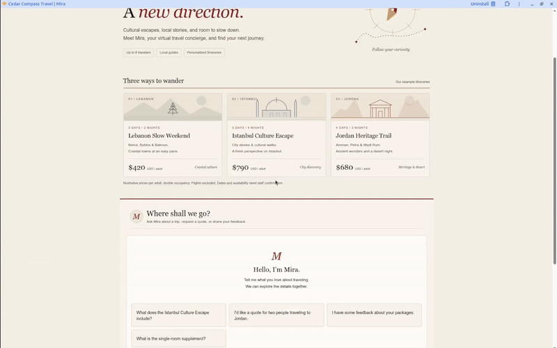

# Assignment 3 — Cedar Compass Travel Agent

Mira is a local travel assistant for a fictional agency. The implementation,
setup instructions, notebook, and tests are in [business_bot](business_bot/README.md).

## Video demonstration

[Download the full-quality demo with audio (MP4)](https://github.com/Suhaib-AbuRaidah/Agentic_systems_assignment_3/raw/refs/heads/main/business_bot/Demo.mp4)

The GIF loops without audio. The MP4 shows the same interactions with full
quality and audio. The app requires an
OpenAI API key for live responses; the key is not included in this repository.
