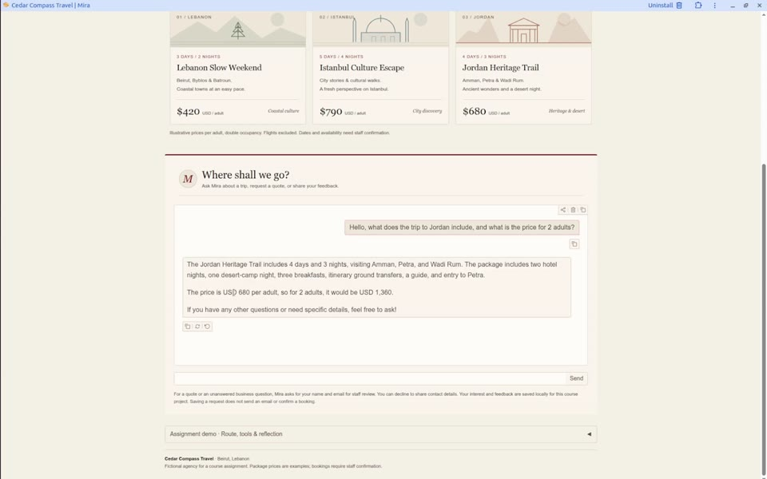

# Assignment 3 — Cedar Compass Travel Agent

Mira is a local travel assistant for a fictional agency. The implementation,
setup instructions, notebook, and tests are in [business_bot](business_bot/README.md).

## Video demonstration

[▶ Watch or download Demo.mp4](business_bot/Demo.mp4)

The video shows real interactions with the local app. The app requires an
OpenAI API key for live responses; the key is not included in this repository.
